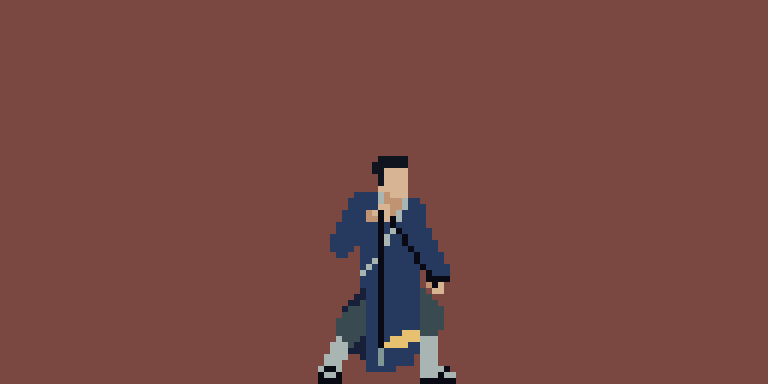
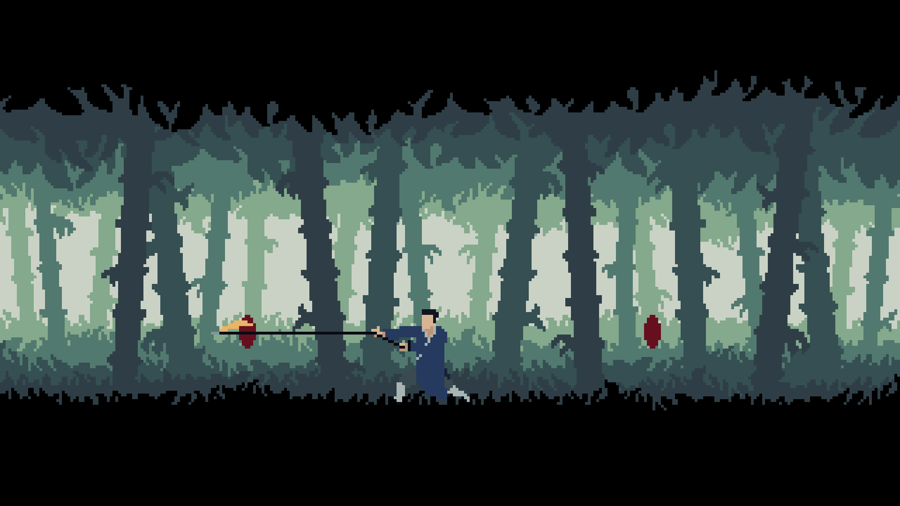
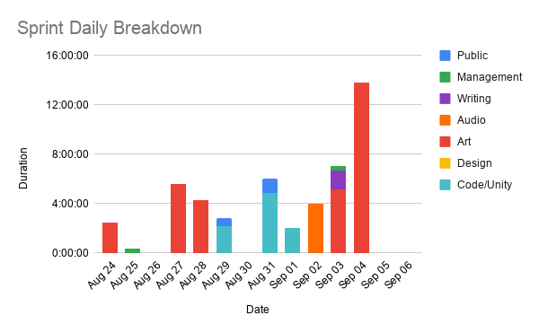
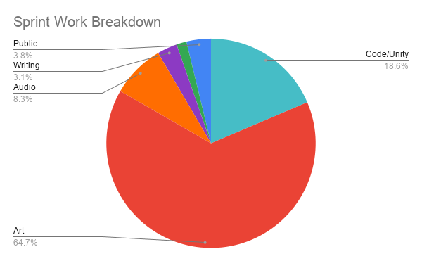

This week, I spent most of my time trying to finish gameplay art, while also starting to create some rough sketches of gameplay music. 

### Animation Progress

I am nearly complete with the minimum viable player animations! This week, I created animations for the dragon and neck wraps. 

I had initially planned to only make two copies of each skill (facing left and facing right), which would allow me to work on other things. However, not long into my work, I hit a pretty significant issue. A core gameplay mechanic is the idea of chaining “wrap” moves in a particular order such that they can be unraveled when performing a shot. In the ideal case, a player performs a dragon wrap, then a neck wrap, and then shoots, all while facing the same direction. 

However, I can already tell that players will rarely follow this exact case. For example, performing a dragon wrap then an elbow shot will result in them facing the opposite direction, while still holding a dragon wrap. If they were to perform a neck wrap, the only animation I had made would have resulted in a wrap that doesn’t unravel. Instead, I needed to create two extra versions of each skill, and some of these require additional turns and footwork. 

### Level Art

Besides animations, I also created my first level environment, a giant bamboo forest! I am imagining this to be the first area of the game, though unless I miraculously find extra time, this will probably be the only area in the first version of the game. 

### Musical First Steps

I have started working on initial sketches for the game’s music! So far, I have an idea for some kind of level complete sting, as well as the beginnings of a gameplay level melody. I think the current version is a bit too upbeat and positive for the game’s tone, so I will probably need to rework it a bit to evoke a more minor tone. 

Level Complete Sting: 
<audio src="/audio/2026-09-08-sting-demo.mp3" controls>
  Your browser does not support the audio element.
</audio>

Gameplay Theme: 
<audio src="/audio/2026-09-08-gameplay-demo.mp3" controls>
  Your browser does not support the audio element.
</audio>

In order to fit the Chinese-inspired setting, I am writing everything using a pentatonic major scale, which was commonly used in traditional Chinese music. Additionally, I am using virtual instruments to replicate the sounds of common instruments, including the guzheng (zither), erhu (two-string fiddle), pipa (lute), and dizi (bamboo flute). While I have been able to find decent free versions of VST (Virtual Studio Technology) instruments for the erhu, pipa, and dizi, I couldn’t find a free guzheng that fit what I wanted. So instead, I am using a yangqin VST and tweaking the settings to get as close to the sound of a guzheng as possible. 

### Sprint 6 Statistics

This sprint was a bit of a mixed bag in terms of productivity. I struggled with a minor sickness during the first week, and spent the final weekend on a short vacation with my family. On the flip side, in preparation for that break, I made the completely healthy decision to try and grind out an entire weekend’s worth of work on Friday. As a result, almost 14 of the sprint’s 48 and a half hours of work came on one day. 

### Coming Up

With sprint 6 complete, there are only two weeks left before my deadline of September 20! While I still think I can have an initial version of the game published by then, it will likely be far less polished than I had initially hoped. Therefore, I am considering only releasing the game in Early Access, then spending the next few weeks adding additional content until I am satisfied with the game. I think this still meets my original goal of making my work publicly available within my timeframe, while also reducing some of the pressure to crunch while also preparing to go back to school. 

For this week, I want to finish up the minimum player animations, sprites for one basic enemy type, a simple level select screen, and combine them all into a playable demo. If all goes well, I will be releasing my final demo on Itch.io next weekend! 

That’s all for this week, thanks for reading! 
