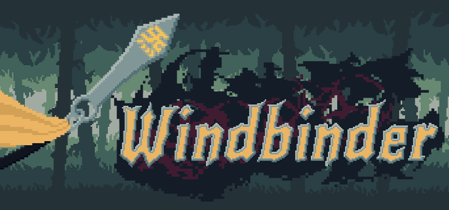
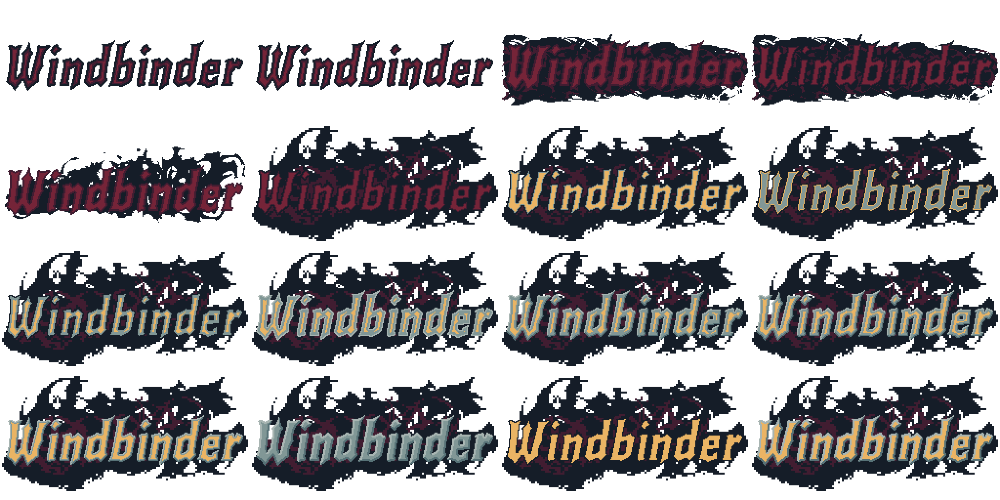
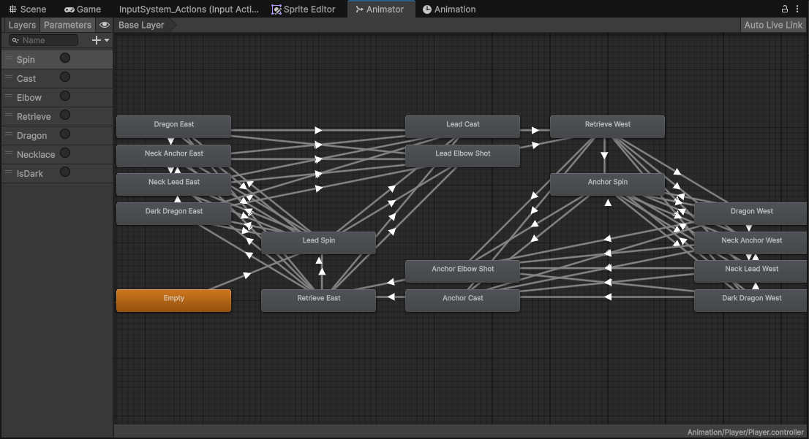
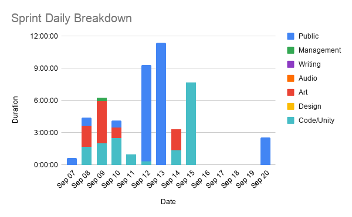
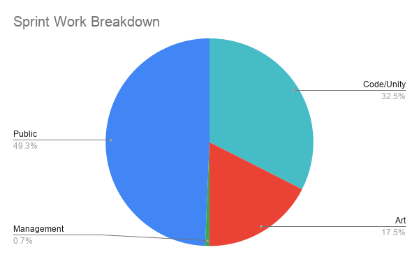
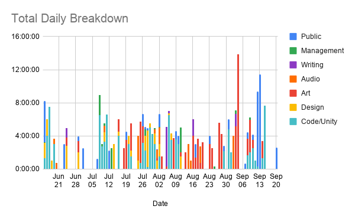
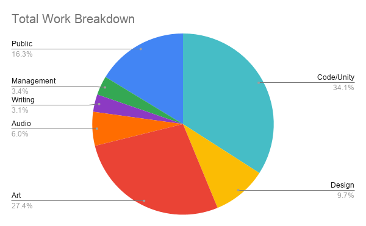
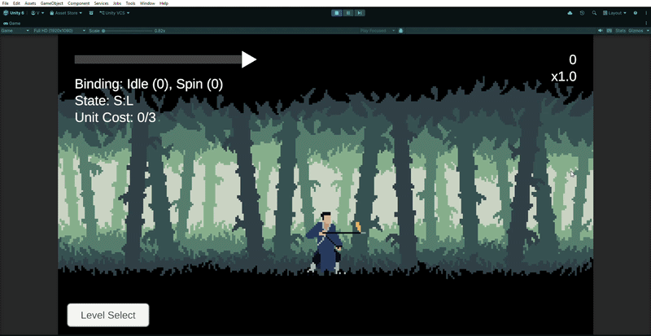

The end of summer has arrived, and we have reached the end of my 14-week development timeline! These last few weeks have been quite the struggle between crunching and preparing to move back to school. Since I missed last week’s devlog due to everything going on, this week’s post will be a bit of a double feature recapping this entire final sprint! 

### Steam Sidequest

Last week, I started working on the game’s Steam store page. As part of this process, I was finally forced to pick a name, and after much deliberation, I have finally settled on…

The main bulk of the work for the store page was creating a set of graphics to be used everywhere from the Steam store to a user’s game library to the Community tab. I used a template created by [Noble Steed Games](https://noblesteedgames.com/blog/a-handy-guide-to-graphical-assets-on-your-steam-store-page/){:target="_blank"} which takes advantage of Photoshop’s Smart Objects, and this helped save so much time when I needed to edit reused assets. 

One of the most difficult assets to finalize was the main title graphic, which you see above. I naturally wanted this to be as representative of the game as possible, while also matching the style of the rope dart it is displayed alongside. I ended up going through so many different variations, some of which you can see below. I selected my favorite versions and put them up for a vote among my family and friends, who ultimately chose the final version! 

With all of the store page graphics complete, I have submitted the page for Steam review. It should hopefully be approved in the next few days, at which point I can make the page publicly visible! 

### Keeping Score

Moving back to the development side of things, I have finally gotten around to finishing the core gameplay systems, most notable being the combo scoring system. Here’s an overview of my philosophy as I designed and implemented the system: 

I want to reward the player for chaining moves together with as few empty spins as possible, so the system is heavily centered around a single multiplier value. Performing moves adds their respective base point values to a temporary “primed” score value, while also increasing your multiplier up to a maximum of x3. If you let the rope spin without performing any moves, your multiplier decreases with each revolution down to a minimum of x1. Finally, casting the dart out and hitting an enemy multiplies the primed score by your current multiplier, and adds the product to your overall level score. 

### Smooth Moves

After designing the score system, however, I realized that the animation system didn’t allow players to immediately chain one move into another, which always resulted in at least one empty spin between moves. While I could have just allowed one penalty-free spin per move, I felt that this made the game feel slow and just didn’t capture the flowing rope dart action I wanted. 

So, I found myself faced with an all-too-familiar task: rewriting the animation system. This time, I was at least able to reuse the underlying graph of bindings, and representing these smooth transitions was as simple as adding new connections between points in the graph. However, the existing input system was incredibly brittle and the mid-binding inputs would frequently get eaten at best or cause a complete crash at worst. 

The main issue I needed to solve was how best to detect the end of an animation, at which point I could read a buffered input and transition to the new move. One option was to use Unity’s built-in animation events and place an event on the final frame of each animation. However, these are notoriously inconsistent, and I wanted more freedom with potentially transitioning between animations at arbitrary frames. 

Instead, my new system runs a coroutine that directly monitors the animator’s normalizedTime value and stores the player’s latest input. When normalizedTime reaches a valid transition point in the animation, the script checks the stored input and if it leads to a valid transition, it sets a trigger in the animator to start the new animation. Finally, to tie everything together and ensure no invalid transitions were possible, I set up all of the possible states and transitions in the animator. 

Not only does the new system allow for the instant binding transitions I wanted, but it is also much more stable and consistent. I might regret writing this, but I think I finally have an animation system that is stable, scalable, and will be usable for any future functionality I add to the game! 

### Sprint 7 Statistics

This sprint was always going to be difficult. As it’s the last sprint in my original development timeline, I came in knowing that I would need to crunch decently hard to have a finished product by today. At the same time, I also had to move into a new apartment for this next school year. All in all, I worked for almost 51 hours over these last two weeks. 

### Project-Wide Statistics

In addition to sprint statistics, I’ve been compiling stats for the entire 14-week project. As of today, I have spent 310 hours and 21 minutes of my summer break working on Windbinder! 

Looking back at the timeline graph, I have some mixed emotions. On one hand, I am immensely proud of how I’ve stayed committed, even despite ebbs and flows in productivity. On the other hand, I can’t help but look at the large blocks of time I spent programming systems early on that were simply unusable once I started working on art (at least 3 obsolete animation systems, for instance). While design specs will naturally need to evolve over the course of a project, I have definitely learned to avoid over-developing systems without establishing constraints from other disciplines. 

Additionally, I think I never quite achieved proper consistency with my productivity. Coming into the project, I was aware that I tend to work in huge bursts, followed by slow periods. I wanted to try to be more consistent with my daily workloads, which I think I at least partially succeeded at during late July and early August. At the same time, my old habits are still pretty prominent, particularly during the last few sprints (see September 4th). I think what helped the most was having a more rigid daily schedule, as the weeks I felt the most consistent were the ones in which I had work in the mornings, then came home and did game dev in the afternoons. Collecting all of this data has been a fun side activity, but I think it will pay off tremendously as I take these lessons into my future development projects! 

### Current Game Status

Finally, it’s time to address the most important question: is the game complete and ready to publish? 

The short answer: No. 

The longer answer: What do you mean by “publish?”

Unfortunately, Windbinder is simply not in a state where I feel comfortable publishing it for purchase. That being said, the game is actually completely playable, albeit with temporary and incomplete visual assets. The player can choose a level from a menu, perform rope dart moves to defeat enemies and gain points, and go choose a new level. As such, while I don’t think I’m ready to fully release the game yet, I have settled on a middle ground. 

In the next few weeks, I will release a demo build of Windbinder on a publicly visible Steam store page where anyone can download and play the game for free. This demo will contain the first “region” of levels, all with final art, UI, and audio assets. My goal is for the demo to be publicly playable by October 2nd. Then, over the next 10 weeks of my fall quarter, I will work in my spare time to flesh out the game’s content, with the eventual goal of releasing the full game by early December. 

### Looking Forward

Since the game is basically playable, most of the remaining work for the demo will be on art, UI, audio, and general polish. I need to create assets for the main title and level select screens, as well as the gameplay HUD to display the player’s score and the rope’s current status. Additionally, I want to finish the gameplay theme I started a few weeks ago and create a theme that can be used for the title and level select. If I have time remaining after that, I’d like to add some additional visual effects to enhance the feeling of wielding the rope dart, like a dynamic particle trail that gets stronger as you build your point multiplier. 

Thank you so much to everyone who has supported me this summer, whether by sitting in late-night Discord calls, playtesting my demos, giving feedback on art, or even just reading these devlogs! It means so much to me, and this really wouldn’t have been possible without you. 

That’s all for this week, thanks for reading! 
